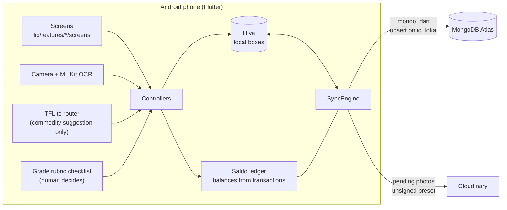
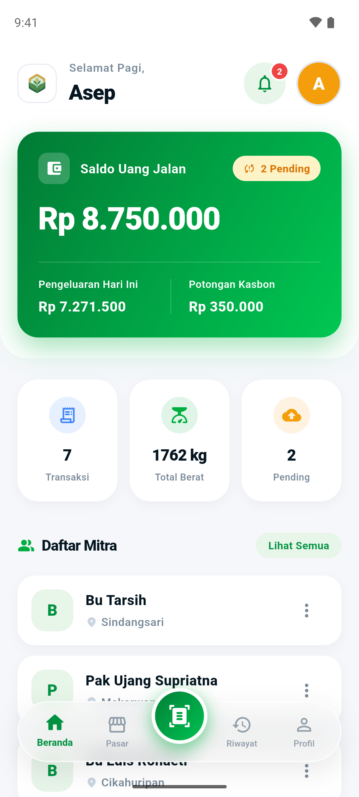
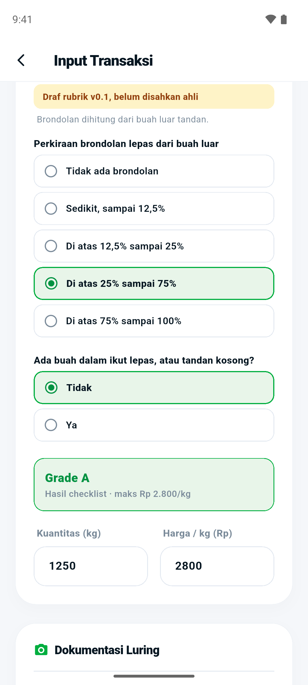
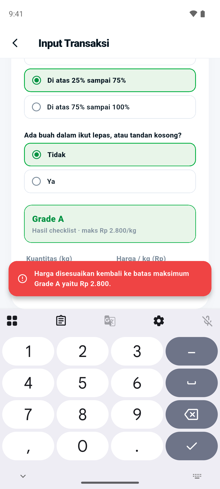
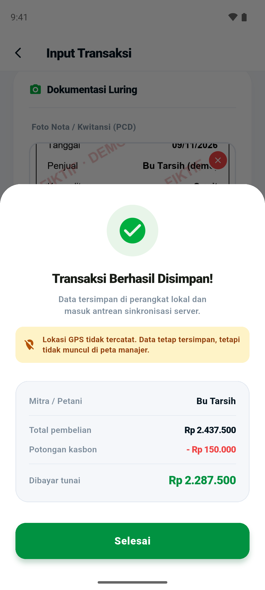
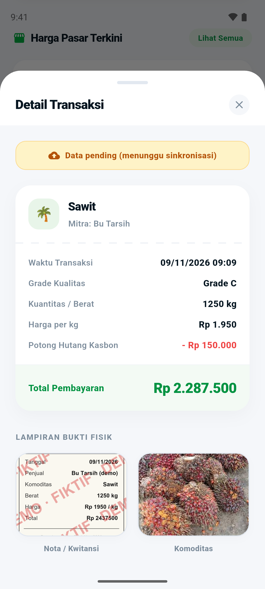
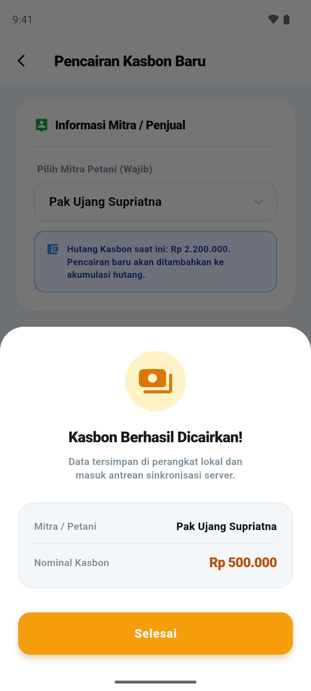
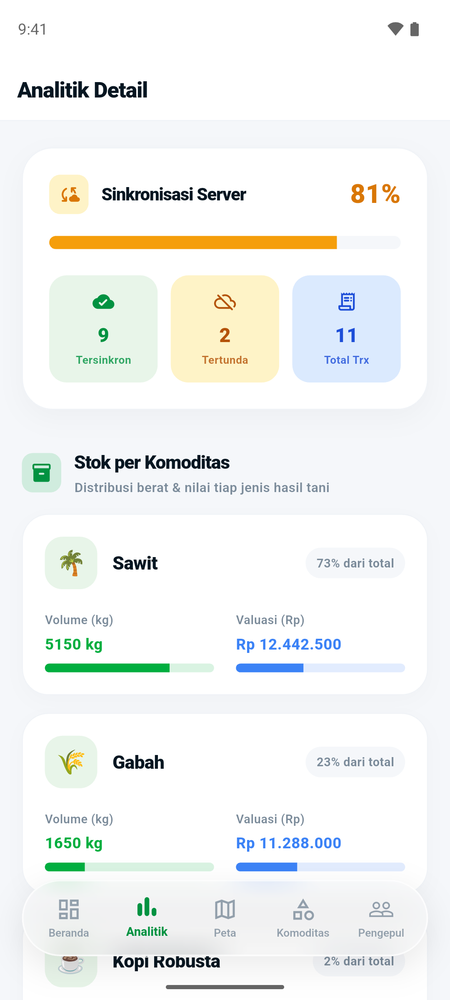
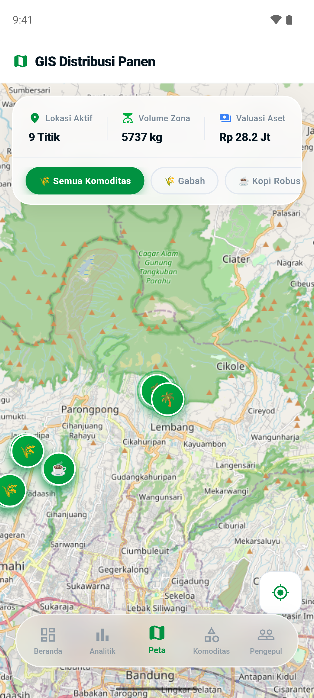

# ReksaTani

ReksaTani is a Flutter Android app for agricultural commodity collectors (*pengepul*) who often work without a mobile signal, and for the managers who oversee them.

A collector records purchases from farmers on the phone while offline. The app deducts the farmer's outstanding advance (*kasbon*) automatically, rejects prices above the manager's per-grade limit, and stores a photo and the GPS location. When a signal is available, the data is sent to MongoDB Atlas.

This is a campus project (Proyek 4, POLBAN, Kelompok C4), still in development.

## What it does

- **Offline-first storage.** Transactions, farmers, commodities, and the login session live in Hive on the device. Recording a purchase needs no internet; the first login does.
- **Idempotent sync to MongoDB Atlas.** `SyncEngine` writes each transaction with an upsert keyed on `id_lokal`, so re-sending after a retry, a crash, or a lost reply does not create duplicates. Sync runs while the app is open: after saving, when connectivity returns, and on pull-to-refresh. There is no background service and no backend server; the phone talks to Atlas directly through `mongo_dart`.
- **Balances derived from transactions.** Advance and travel-money balances are recomputed as `base balance + sum of transaction deltas` (`lib/services/saldo/saldo_ledger.dart`) instead of being incremented, so retries and duplicates cannot make the totals drift.
- **Advances and disbursements.** Purchases deduct the farmer's *kasbon*; disbursements (*pencairan*) are recorded as their own transactions and synced to the manager's view.
- **Maximum price per grade.** Managers set `harga_maks` per commodity grade, and the transaction form rejects prices above it (`0` means no limit).
- **Grade by human rubric.** Grade A/B/C is chosen by the collector through a checklist rubric (`lib/features/pcd_scanner/services/grading_rubric.dart`). An on-device TFLite model only *suggests the commodity*; the user always confirms it, and if they disagree, the user's choice is kept and both are recorded.
- **Manager dashboard.** Purchase analytics, a map of transactions that have coordinates, and management of collectors and commodities.
- **Receipt OCR.** Google ML Kit text recognition reads weight and price from a photographed receipt.

## Architecture

Code is organised by feature under `lib/features/` (`auth`, `transaksi_luring`, `pcd_scanner`, `pengepul_dashboard`, `manajer_dashboard`), with shared services under `lib/services/` (`sync/`, `saldo/`, `foto/`).

## Screenshots

Demo data, Nov 2026: fictional names and amounts seeded into Hive on an emulator, with no connection to Atlas. Camera screens use the emulator camera feed with public-dataset photos as posters (credited in the index). The full flow (42 screens) with notes is in [`docs/screenshots/INDEX.md`](docs/screenshots/INDEX.md).

| Collector home | Grade rubric | Price limit | Saved without GPS |
| :---: | :---: | :---: | :---: |
|  |  |  |  |
| **Proof photos** | **Kasbon disbursement** | **Manager analytics** | **Manager map** |
|  |  |  |  |

## Getting started

Requirements: Flutter (CI uses 3.47.5, Dart SDK `^3.11.4`) and an Android device or emulator.

1. Copy `.env.example` to `.env` and fill in `MONGO_URI`, `CLOUDINARY_CLOUD_NAME`, and `CLOUDINARY_UPLOAD_PRESET`.
2. Generate `lib/core/env/env.g.dart` (not tracked by git):
   `dart run build_runner build --delete-conflicting-outputs`
3. Run the app: `flutter run`

For a release build, create `android/key.properties` with `storeFile`, `storePassword`, `keyAlias`, and `keyPassword`; without it, the release build is signed with the debug key. Before a release, follow the [Atlas runbook](tool/atlas/README.md).

## Tests and CI

- `flutter test` runs **648 tests** (counted on 2026-11-12). They use an in-memory `FakeRemote`, and `test/flutter_test_config.dart` blocks real database and HTTP connections, so the suite never reaches Atlas.
- One smoke test, `tool/atlas/uji_asap.dart`, runs the real `MongoRemote` and `SyncEngine` against Atlas on its own `asap-` documents and deletes them afterwards. It is run by hand, not in CI.
- GitHub Actions (`.github/workflows/ci.yml`) runs `flutter pub get`, `flutter analyze` (fails on errors only), and `flutter test` on every push and pull request. CI writes an empty `env.g.dart`, so it needs no secrets.

## Limitations

- **Database credentials ship inside the APK.** The MongoDB URI is only obfuscated by `envied`; anyone who extracts it gets that account's access to the database.
- **RBAC is client-side only.** The collector and manager roles decide which screens appear; the database does not restrict access per role.
- **The grade rubric is a draft (`v0.1-draf`)** and has not been reviewed by a domain expert.
- **The AI model only suggests the commodity** and has not been validated on field data.
- **Sync is tested with fakes plus one Atlas smoke test.** Passing with fakes is not proof of Atlas behaviour, and several paths (login, commodity management, Cloudinary upload, GPS on a real device, starting offline then going online) have not been exercised against the real services.
- **No multi-document transactions.** Each write to Atlas is a separate operation; consistency relies on idempotent upserts and recomputed balances, not on atomic commits.
- **Login still has a plaintext-password fallback for old accounts.** If `password_hash` is not a bcrypt hash, it is compared as plain text; a successful login rehashes it with bcrypt and writes it back. New and edited accounts are stored with bcrypt. No bulk migration has been run, so accounts that never log in keep their plaintext value until the Atlas data is checked.
- Cloudinary uploads use an unsigned preset, and login is checked on the device against the `password_hash` read from the cloud.

More detail (in Indonesian) is in [docs/TECHNICAL.md](docs/TECHNICAL.md).

## Team

Campus project for Proyek 4, D-3 Teknik Informatika, Politeknik Negeri Bandung (POLBAN), Kelompok C4.

- **Hisyam Khaeru Umam** (Umem): Project Manager, Full Stack, integrator
- **Muhammad Ihsan Ramadhan**
- **Ibnu Hilmi Athaillah**
